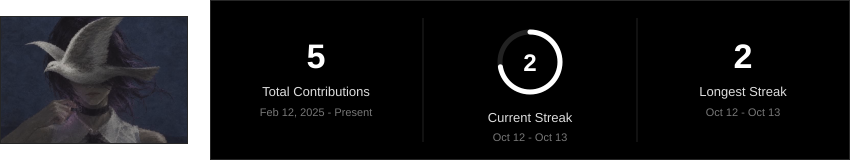

——— Tears ———

  
<em>Everyone Has the Same Chance</em>
 

<table> <tr> <td width="50%">◆ Class -> Student / Full-Stack Apprentice 
◆ Origin -> Indonesia 
◆ -> Obsessed With OpenSource & FLOSS</td> <td width="50%" align="center">✦</td> </tr> </table>

Technologies

Statistics

Linux

Contribution Graph

